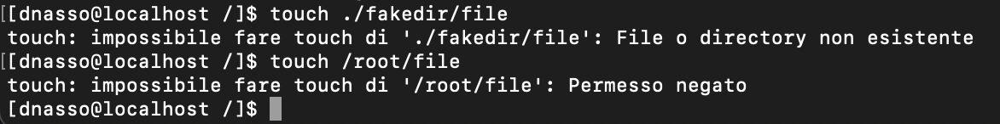
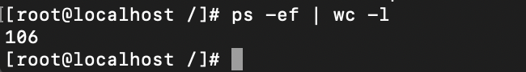
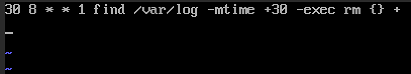

# Esercizi Extras Corretti (Track 1)

Ho aggiunto la correzione all'esercizio 3, in quanto confrontandomi mi sono reso conto di aver capito male la consegna.

Per ogni esercizio, ho inserito anche il collegamento ad ogni script ".sh" su cui ho lavorato, in modo da allenarmi con la sintassi di Markdown. Siccome nella email di report non saranno presenti i file, ho inserito, per ovviare al problema, anche gli screenshot di ogni script.


## Esercizio 1


I due casi che mi sono venuti in mente sono i seguenti:



Come possiamo notare, nel primo caso non è possibile eseguire il comando touch poiché la directory nel percorso indicato non è esistente (fakedir).

Nel secondo caso, invece, non è possibile eseguire il comando in quanto stiamo creando un nuovo file in una directory di root, quindi per mancanza di permessi.


## Esercizio 2


Per il secondo esercizio mi è bastato utilizzare i comandi ps e wc, concatenati da pipe.

"ps -e" mi permette di vedere tutti i processi, di ogni utente, attualmente attivi sulla macchina.

"wc -l", invece, conta e stampa in output il numero di righe del testo che gli viene passato. In questo modo, quindi, lo script, una volta lanciato, stampa in output il numero di processi attualmente avviati sulla macchina:




## Esercizio 3


Il metodo che inizialmente ho trovato per capire se il kernel attualmente in esecuzione è il più recente disponibile, è quello di utilizzare il comando "dnf check-update kernel".

Tramite questo comando, se non viene stampato "standard output", sappiamo già di aver installato l'ultima versione disponibile; in caso contrario, viene stampata come "standard output" l'ultima versione disponibile per l'installazione.

Cercando nel man, però, ho trovato il comando "dnf repoquery" ed ho deciso di proseguire con quello.

Il comando dnf repoquery, con l'opzione "--latest-limit=1" cerca nei repository l'ultimo pacchetto disponibile indicato.

Con "2>/dev/null" ho reindirizzato lo standard error, in modo da avere solamente la riga di testo che mi interessava.

Con il pipe, poi, ho collegato il comando "cut", che mi è stato utile per togliere la prima parte "kernel0:" dello standard output, che non mi serviva, utilizzando ":" come delimitatore e prendendo solamente il secondo campo. Per sicurezza ho aggiunto la flag "-s", in modo da non prendere stringhe di testo senza il delimitatore, anche se in questo caso specifico non era necessario.

Tutto questo, viene sottoposto a "confronto di uguaglianza" con il comando "uname -r", in modo da verificare se le stringe sono uguali. Se sì, lo script stamperà "TRUE", altrimenti "FALSE".

Di seguito, il collegamento al file [(File_3)](sh/kernel-version.sh) e lo script:

```{.bash .include}
sh/kernel-version.sh
```


## Esercizio 3 (Corretto)


Per fare la correzione del terzo esercizio ho utilizzato innanzitutto il comando "rpm -q kernel" per ottenere la lista dei kernel presenti nel sistema. 

Poi ho riordinato l'elenco in base alla versione lanciando il comando "sort" con l'opzione "-V" e selezionato solamente la riga utile, attraverso il comando "tail -n 1".

Infine, con il comando "cut -d'-' -f 2-", ho preso dal secondo campo in poi, "eliminando" il primo campo che non mi serviva.

Script:


```{.bash .include}
sh/kernel_correzione.sh
```


## Esercizio 4


Per svolgere l'ultimo esercizio, ho prima cercato di capire quale fosse la sintassi corretta del comando "find" per cancellare i file più vecchi di 30 giorni:

find /var/log -type f -mtime +30 -exec rm {} +

Ho utilizzato "-type f" per evitare errori con le directories, in modo che il "rm" eliminasse solamente "file".

"-mtime +30" indica i file più vecchi di 30 giorni.
"-exec rm {} +" permette, invece, di eliminare tutti i file trovati dal comando "find".

Una volta trovato il comando, ho fatto uno script ".sh" in modo da poter lanciare il comando in qualsiasi directory, sostituendo "." a "/var/log".

Di seguito, il collegamento al file [(File_4)](sh/delete-30.sh) e lo script:


```{.bash include}
sh/delete-30.sh
```


Successivamente, ho utilizzato il comando "sudo crontab -e" per aprire la tabella nel quale schedulare il comando:



Per comprendere la sintassi di completamento corretta ho cercato su google, in quanto, purtroppo, non sono stato in grado di capirla dal manuale. Infine ho utilizzato il comando "crontab -l" per verificare effettivamente che la stringa fosse inserita.


